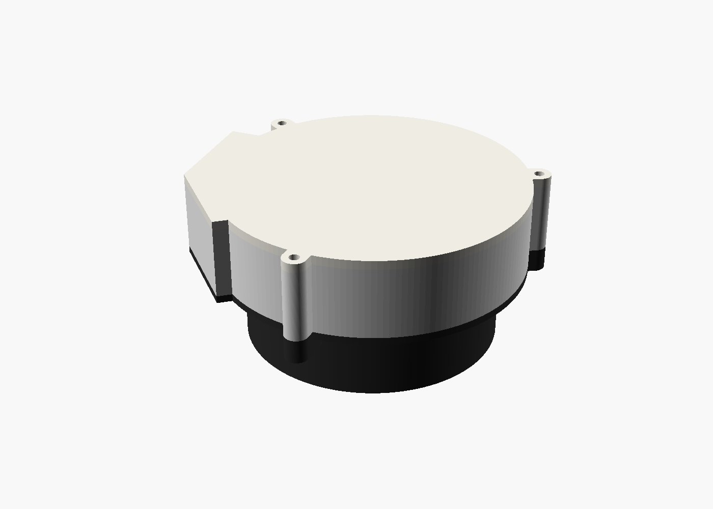
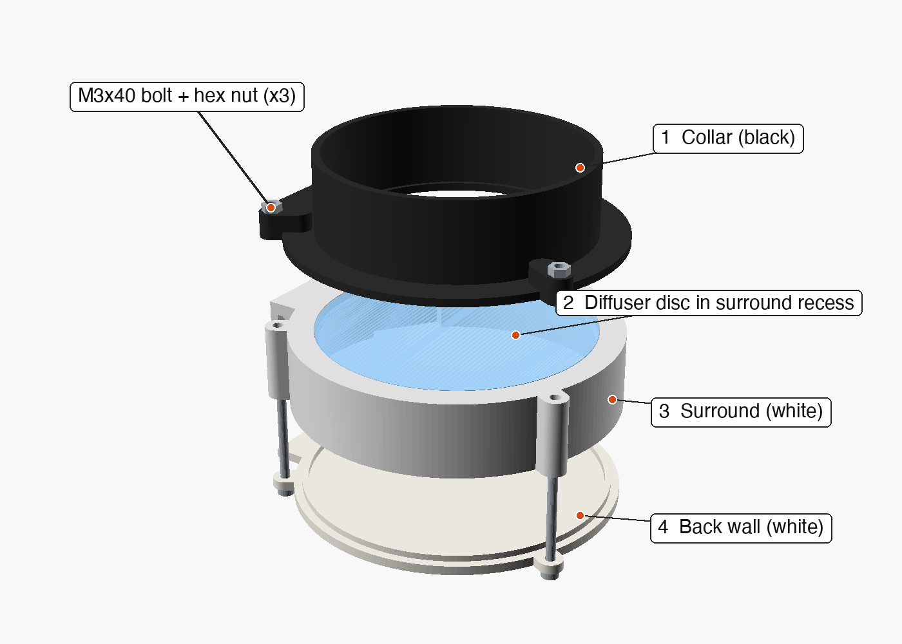
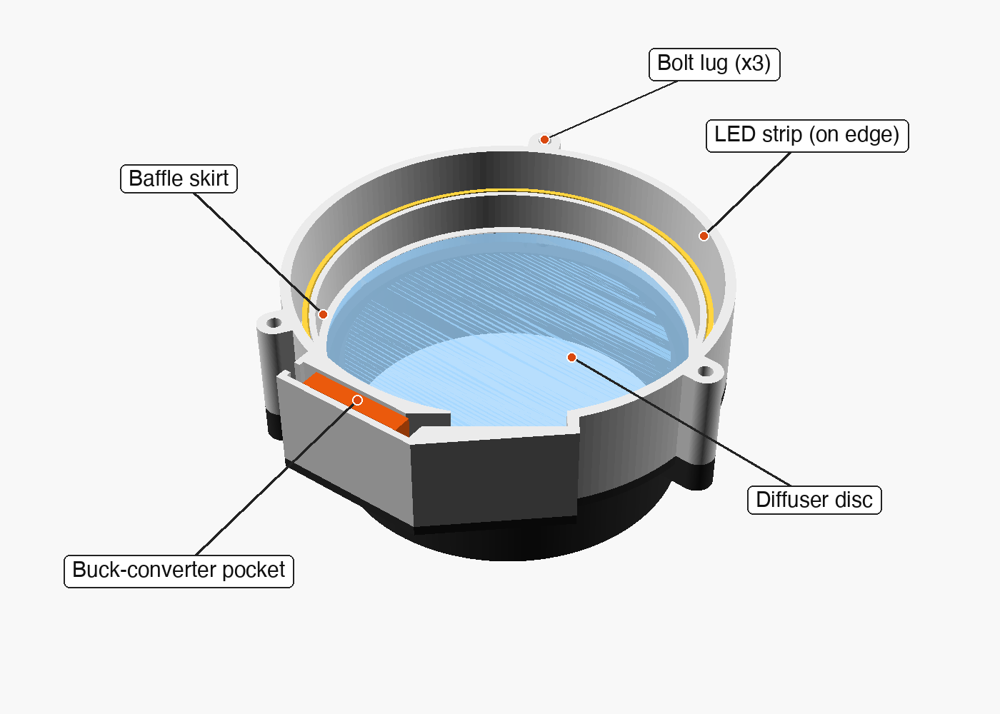
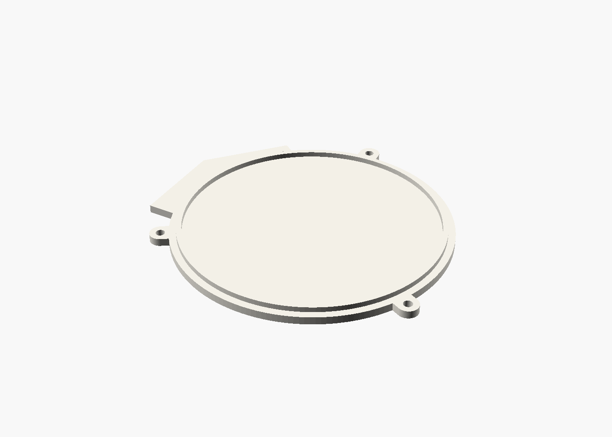
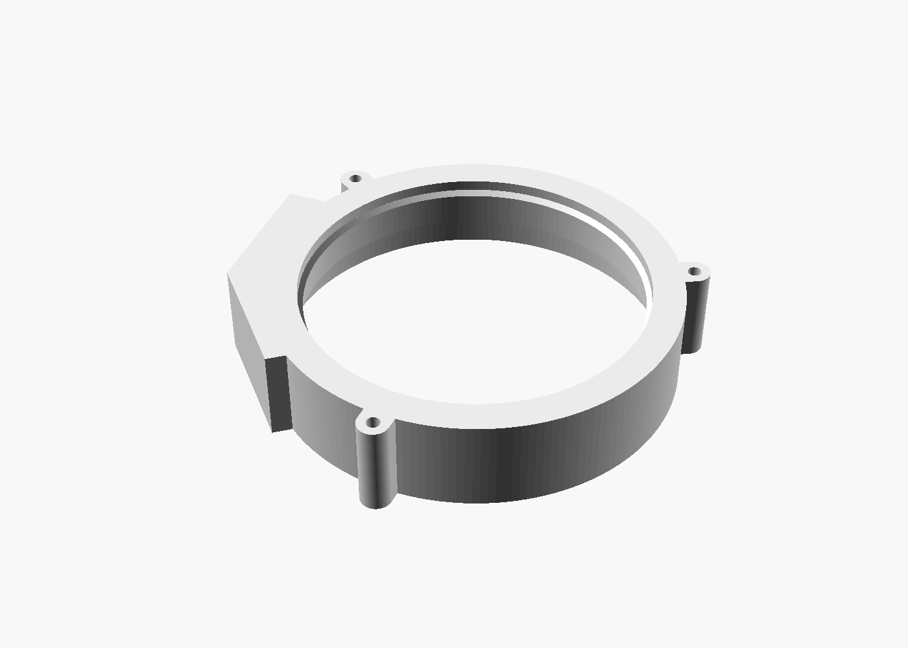
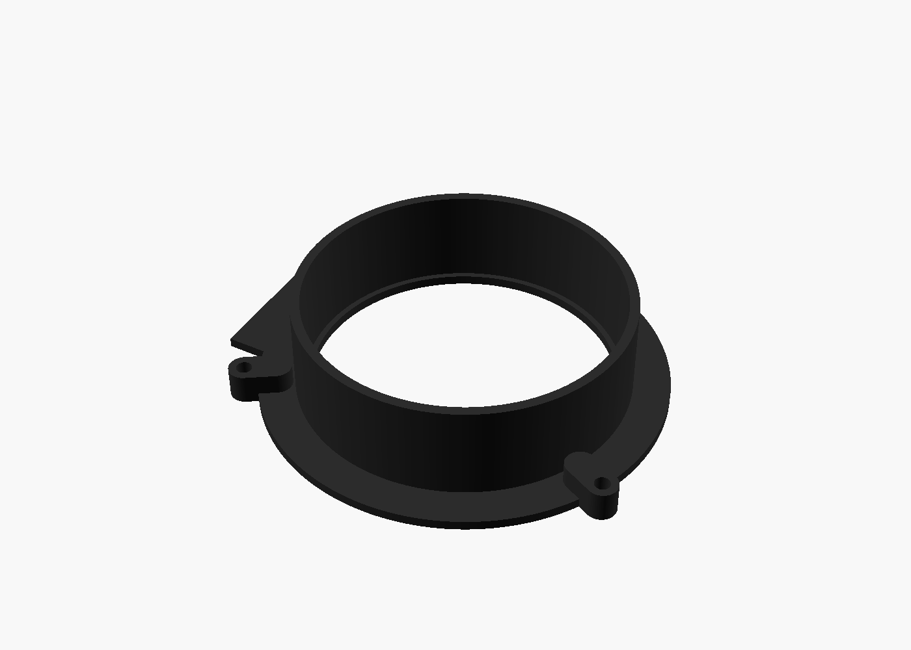
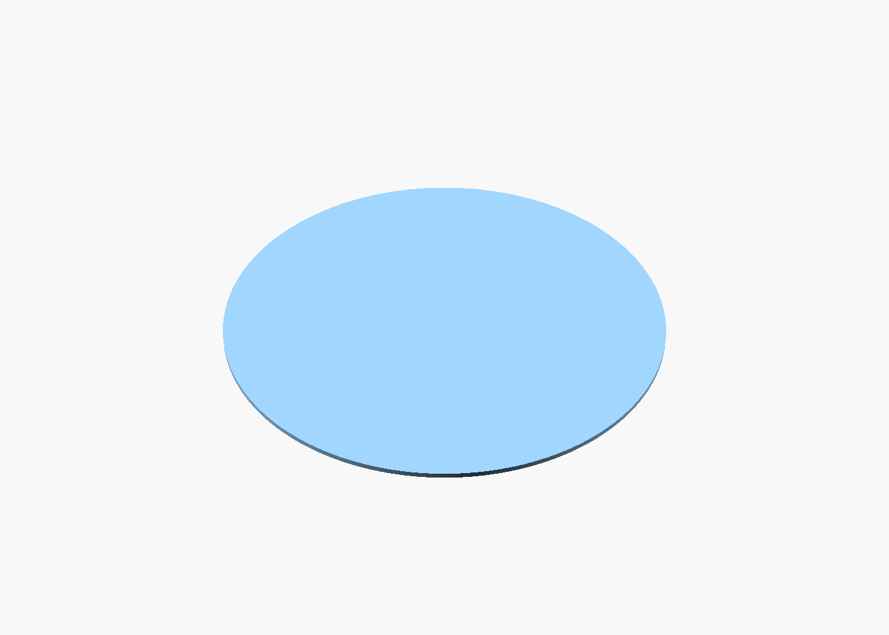
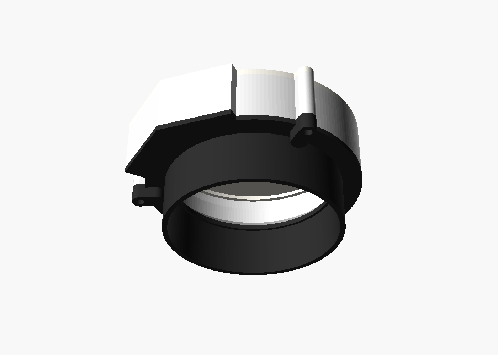
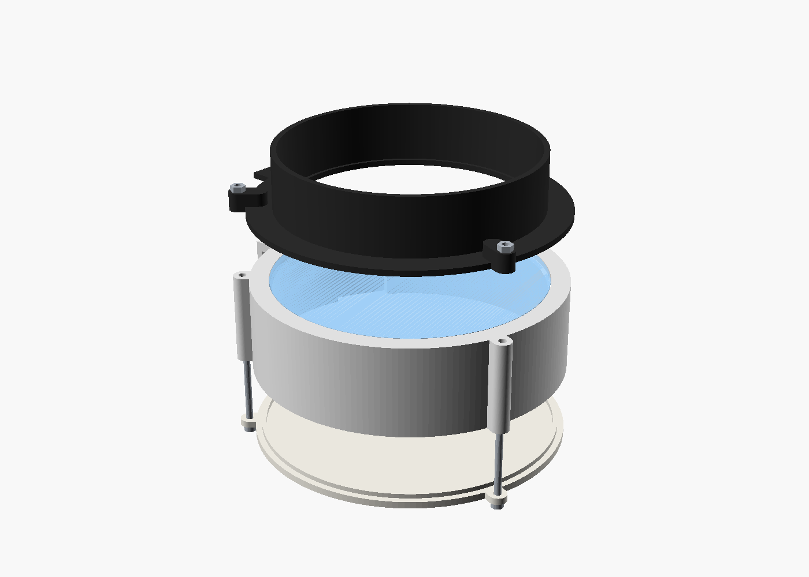

# RedCat 51 II Flat Panel

A cheap, 3D-printed, slip-on **flat-field panel** for the William Optics RedCat 51 II (the same design also works for lenses with a similar front end if you scale it - see [Scaling it up](#using-and-scaling-the-openscad-file)).

Three support-free printed parts, an 88 mm diffuser disc (**3D-printed, so the whole project can be printed** - or laser-cut acrylic if you prefer), a ring of 12 V LED strip, and a small buck converter that dials the brightness down to something a camera can use for flats. Everything is held together by three M3 bolts.

> **Set it once and forget it.** The panel is designed so you set the brightness a single time, during assembly, and never touch it again. The converter's dimming trim pot is sealed inside the cavity: there is **no access hole or screw hole to adjust it** once the back wall is bolted on, and changing it later means taking the panel apart. That's why the brightness is set during the test fit in [Assembly](#assembly) step 7, *before* you close it up. After that, vary your flats' exposure time or gain, not the panel.



Contents: [How it works](#how-it-works) · [Bill of materials](#bill-of-materials) · [Optional components](#optional-components) · [Files](#files-in-this-repo) · [Printing](#printing) · [Assembly](#assembly) · [Using it](#using-it) · [Using and scaling the OpenSCAD file](#using-and-scaling-the-openscad-file) · [Limits of scaling up](#limits-of-scaling-up)

---

## How it works

Light from the LED strip never shines straight at the diffuser. The strip stands on edge in a ring around a small baffle skirt, so it only reaches the diffuser after bouncing around the cavity, which evens the light out. The diffuser disc sits in a recess in the front of the surround and is clamped by the collar flange. The collar is the slip-on part that goes over the telescope's dew shield.

Part order, from the telescope side to the back:

| # | Part | What it does |
|---|------|--------------|
| 1 | **Collar** | Slides over the RedCat dew shield (81 mm inside diameter, stops against an internal lip). Its flange clamps the diffuser. Three tabs carry the bolts' nuts. |
| 2 | **Diffuser disc** | 88 mm disc. Print it 0.6 mm or 1.0 mm thick, or use 3 mm opal acrylic. Drops into the surround's front recess. |
| 3 | **Surround** | Holds the diffuser, the baffle skirt, the LED ring, a channel for the strip connector, and a pocket for the buck converter. |
| 4 | **Back wall** | Closes the cavity and the converter pocket. A thin spigot ring locates it in the surround. **Print it in white** - its inside face is the reflector that bounces the LED light toward the diffuser. |



### Where everything fits

The back wall is left off in this view so you can see inside. The strip connector sits in the channel next to the converter pocket, and the wires run through the open slot between them.



Render colours only tell the parts apart. For the real build, see [Filament colours](#filament-colours): the back wall must be white.

---

## Bill of materials

Full list with short Amazon links: **[bom/BOM.pdf](bom/BOM.pdf)** (source: [bom/bom.html](bom/bom.html)).

**Required**

| Item | Notes |
|------|-------|
| 22 AWG solid hook-up wire, red + black | |
| 12 V LED strip, SMD 2835, natural white 4500 K, 10 mm wide | About 30 cm used. Non-waterproof is fine. |
| MP1584EN buck converter | 1 of the 8-pack. Its trim pot sets the brightness once, during assembly. |
| 12 V barrel-plug pigtails, 2.1 x 5.5 mm | Plug into your existing 12 V supply. |
| PLA+ filament, black + white | The back wall must be white. |
| 3 x **M3x40** bolts, 3 x M3 hex nuts | From any M3 screw kit. |
| Diffuser disc | Printed from [stl/printed-diffuser/](stl/printed-diffuser/). No purchase needed. |
| 12 V power source | Not in the BOM. Use your rig's. |

**Tools:** soldering iron, rosin-core solder, heat-shrink tubing, multimeter, small screwdriver (for the trim pot, assembly only).

### Cost of one panel

The BOM shows pack prices. One panel uses a slice of each pack:

| Material | Used | Cost |
|----------|------|------|
| PLA+ (all parts, printed diffuser included) | up to ~130 g | ~\$1.50 |
| LED strip | ~0.3 m of 5 m | ~\$0.90 |
| Buck converter | 1 of 8 | ~\$0.95 |
| DC pigtail pair | 1 of 5 | ~\$1.20 |
| Hook-up wire | ~2 ft | ~\$0.30 |
| M3 bolts + nuts | 3 + 3 | ~\$0.15 |
| COB connector (optional) | 1-2 of 20 | ~\$0.45-0.90 |
| **Total** | | **about \$5-6** |

Buying the packs as listed costs **\$77.73**, plus \$18.98 for the optional items and about \$53 for tools if you own none. Single-item retail prices, shipping and tax are not included.

---

## Optional components

None of these are needed for a working panel.

| Optional item | Without it |
|---------------|------------|
| **Acrylic diffuser**, 88 mm x 3 mm opal | Use the printed diffuser. For acrylic, laser-cut [diffuser/diffuser_88mm.dxf](diffuser/diffuser_88mm.dxf) and print the standard `flat_panel_surround.stl` (3 mm recess). |
| **M3 heat-set inserts** | Not needed. Each M3x40 bolt goes through the back wall, surround lug and collar tab, and a hex nut on the tab end clamps it. With inserts, melt one into each collar tab hole and use M3x35 bolts. |
| **COB strip-to-wire connectors**, 10 mm 2-pin | Solder the wires straight to the strip pads. They fit the same space. |
| **Soldering flux** | Helps solder stick. Rosin-core solder alone works. |
| **Heat-shrink tubing** | Handy for insulating joints. Tape works in a pinch. |

---

## Files in this repo

```
scad/flat_panel.scad          Parametric OpenSCAD source (all three parts)
stl/flat_panel_collar.stl     Ready-to-print parts, built with the default parameters
stl/flat_panel_back.stl
stl/flat_panel_surround.stl   Surround with a 3 mm diffuser recess (for the acrylic disc)
stl/printed-diffuser/         3D-printed diffuser: pick ONE thickness (disc + its matching surround)
    diffuser_0.6mm.stl      surround_for_0.6mm_diffuser.stl
    diffuser_1.0mm.stl      surround_for_1.0mm_diffuser.stl
diffuser/diffuser_88mm.dxf    88 mm circle for laser-cutting an acrylic diffuser (optional)
bom/BOM.pdf                   Bill of materials (PDF, short links)
bom/bom.html                  BOM source
docs/images/                  Pictures used in this README
docs/views.scad               Scene file used to make those pictures
docs/render_images.sh         Regenerates docs/images/ (needs OpenSCAD)
```

---

## Printing

All three parts print **without supports**, in the orientation they are modelled in:

| Part | Orientation on the bed |
|------|------------------------|
| Back wall | Flat on the bed, spigot ring pointing up (**in white**, see below) |
| Surround | Front face (the diffuser recess side) on the bed |
| Collar | Flange on the bed, tube pointing up |
| Printed diffuser | Flat on the bed (white, solid) |

| Back wall | Surround (open side up for the picture; print it flipped) | Collar |
|:--:|:--:|:--:|
|  |  |  |

### Filament colours

**The back wall must be white.** Its inside face is what reflects the LED light back toward the diffuser, so a dark back wall wastes light and makes the panel dimmer and less even.

* **Single-colour printer:** print the whole back wall in white.
* **Multi-colour printer (e.g. Bambu AMS):** you can print the back wall in any colour as long as the top is white - the spigot side that faces into the cavity. Cover that top face with white layers.

The cavity walls of the surround reflect light in the same way, so light plastic there helps for the same reason; the collar's colour doesn't affect the light.

### Printed diffuser

The diffuser is a plain 88 mm disc. Choose a thickness and print **both** files with that thickness, because the surround's recess depth matches the disc so the disc ends up flush with the front face and the collar flange clamps it:

| Thickness | Disc | Matching surround |
|-----------|------|-------------------|
| 0.6 mm | [diffuser_0.6mm.stl](stl/printed-diffuser/diffuser_0.6mm.stl) | [surround_for_0.6mm_diffuser.stl](stl/printed-diffuser/surround_for_0.6mm_diffuser.stl) |
| 1.0 mm | [diffuser_1.0mm.stl](stl/printed-diffuser/diffuser_1.0mm.stl) | [surround_for_1.0mm_diffuser.stl](stl/printed-diffuser/surround_for_1.0mm_diffuser.stl) |



Print the disc flat on the bed, in white filament, solid (100 % infill - at these thicknesses it is only a few layers anyway). Do **not** also print the standard `flat_panel_surround.stl`; use the matching one from this table. A thicker disc diffuses more but passes less light, so if you find the panel too dim for your flats, try the thinner disc; if you can see the LED ring or hot spots, try the thicker one.

### Fit check

Check that the diffuser drops into the recess without forcing. If your disc (printed or acrylic) is a different thickness, set `diffuser_t` to it (and `diffuser_d` for the diameter) and re-export the surround.

---

## Assembly

Do a dry fit of the printed parts and the diffuser before you wire anything.

1. **Print the parts and the diffuser.** Print the collar, back wall, and *either* the printed-diffuser pair (disc + its matching surround) *or* the standard surround with an acrylic disc. Clean any elephant's foot off the edges so the parts seat flat.
2. **Wire the converter.** Solder the pigtail's two leads to the converter's **IN+ / IN-** pads. Plug the pigtail into your 12 V supply and, with a multimeter on **OUT+ / OUT-**, check what it reads. These converters usually ship set to a very low output, so leave the trim pot alone for now (the real brightness is set in step 7). Unplug before continuing. Heat-shrink the joints.
3. **Prepare the strip.** Cut about 30 cm of LED strip at a cut mark (roughly pi x the skirt's 93 mm outside diameter). Attach two wires (red = +, black = -) to the **start** of the strip with a COB clip connector, or solder them to the pads. Connect those wires to the converter's **OUT+ / OUT-** pads. Keep the wires long enough to run from the connector channel into the converter pocket through the side slot.
4. **Seat the diffuser.** Lay the surround on the bench with its front face up and drop the diffuser disc into the recess - it rests on the 45-degree seat and should sit flush with the front face. Place the collar on top, flange down, lining up the three bolt lugs and the connector-box outline, so the flange clamps the disc's edge.
5. **Flip the stack so the open back faces you.** Press the strip around the outside of the baffle skirt, standing on its edge on the front ring, with the **LEDs facing outward toward the cavity wall**. Drop the connector into its channel (it slides in from the open back and rests on the front ring).
6. **Fit the converter.** Slide the buck converter into its pocket from the back, then feed its wires through the slots as shown in the picture above (strip wires through the side slot, DC input leads out through the slot at the far end of the pocket). Leave the DC leads long enough to reach your supply.
7. **Test fit, and set the brightness now.** This is your only chance to set the dimming: once the back wall is bolted on, the trim pot can't be reached. Plug in the supply. **Don't be alarmed if you see no light at first:** the converter's output is set very low by default, so on your first power-up the strip will probably look off. Turn the trim pot up slowly (a small screwdriver, with the multimeter on the output if you like) until the strip comes on, then check that the diffuser glows evenly and fix any pinched wires. Then, with the back wall still off, slide the collar onto your scope, take short test exposures with your camera, and turn the converter's trim pot until the exposure is where you want it for flats, e.g. a histogram peak in the middle of the range at an exposure time you're happy with. Aim for a level that works across all your filters, since you'll fine-tune later with exposure time or gain. Unplug when you're done and don't touch the trim pot again. (If you'd rather have an externally adjustable dimmer, the back wall would need modifying; this design has no provision for one.)
8. **Close the back.** Seat the back wall's spigot ring into the surround, keeping wires clear of the lugs and the edge.
9. **Bolt it together.** Push an **M3x40 bolt** through each lug from the back wall side. Thread an **M3 hex nut** onto the end of each bolt where it comes out of the collar tab, holding the nut with your fingers or tweezers while you turn the bolt. Tighten evenly, just snug - it's plastic.
   With heat-set inserts: melt them into the collar tab holes first, then use M3x35 bolts. They thread straight in, so no nuts.



---

## Using it

1. Slide the collar over the RedCat's dew shield until it stops against the internal lip.
2. Plug the pigtail into 12 V. The brightness is already set (in assembly step 7) and can't be adjusted from outside, so there is nothing to turn.
3. Take your flats, changing exposure time or gain per filter as needed, then slip the panel off.

If the brightness turns out to be wrong for your setup, you have to unbolt the back wall and re-adjust the converter's trim pot (see [Assembly](#assembly) step 7).

---

## Using and scaling the OpenSCAD file

[scad/flat_panel.scad](scad/flat_panel.scad) is a single file that produces all three parts. It works with [OpenSCAD](https://openscad.org) 2021.01 or newer.

### Picking a part

At the top of the file:

```openscad
part = "all"; // [back, surround, collar, diffuser, all, exploded]
```

* **In the GUI**, open the Customizer (Window menu) and pick the part from the drop-down. Use `all` to see it assembled, `exploded` to see how it fits together, and `diffuser` for the printable disc. Render (F6) and **File > Export > STL** to print.
* **From the command line** (also handy for scaling):

```bash
openscad -o stl/flat_panel_collar.stl   -D 'part="collar"'   scad/flat_panel.scad
openscad -o stl/flat_panel_surround.stl -D 'part="surround"' scad/flat_panel.scad
openscad -o stl/flat_panel_back.stl     -D 'part="back"'     scad/flat_panel.scad
```

The printed diffuser needs the disc **and** a surround built with the same thickness:

```bash
openscad -o stl/printed-diffuser/diffuser_1.0mm.stl            -D 'part="diffuser"' -D diffuser_t=1.0 scad/flat_panel.scad
openscad -o stl/printed-diffuser/surround_for_1.0mm_diffuser.stl -D 'part="surround"' -D diffuser_t=1.0 scad/flat_panel.scad
```

Any parameter can be overridden the same way, e.g. `-D collar_id=95 -D collar_depth=30`.

### What the parameters mean

Defaults are for the RedCat 51 II. All lengths are millimetres.

| Group | Parameter | Default | Meaning |
|-------|-----------|---------|---------|
| Fit | `collar_id` | 81 | Inside diameter of the slip-on collar. **Measure your scope's dew shield (or hood) and add about 1 mm.** |
| | `collar_depth` | 25 | How far the collar slides on. |
| | `wall` | 2.5 | Wall thickness of the collar and the surround. |
| | `lip_id` | 78 | Opening of the internal stop lip. It must be smaller than `collar_id` so the scope bottoms out, and still bigger than your optics' clear aperture so it doesn't vignette. |
| | `flange_t` | 2.5 | Thickness of the collar flange that clamps the diffuser. |
| Diffuser | `diffuser_d` | 88 | Diameter of the diffuser disc (printed or acrylic). |
| | `diffuser_recess_d` | 88.5 | Recess it sits in (about 0.5 mm bigger). |
| | `diffuser_t` | 3 | Disc thickness - the recess depth, and also the thickness of the printed `diffuser` part. **Measure your disc**, or set 0.6 / 1.0 for a printed one. |
| | `seat_id` | 86 | Light opening; the disc rests on this ring (about 2 mm smaller than the disc). |
| Cavity | `cavity_id` | 100 | Inside diameter of the LED chamber. |
| | `cavity_depth` | 20 | Chamber depth. |
| | `front_t` | 4 | Thickness of the front ring (includes the diffuser recess). |
| | `skirt_id` / `skirt_t` / `skirt_len` | 90 / 1.5 / 10 | The baffle skirt that hides the LEDs from the diffuser. `skirt_len` should match your strip width. |
| Back wall | `back_t`, `spigot_h`, `spigot_w`, `spigot_clear` | 3, 2, 2, 0.2 | Plate thickness and the locating ring (clearance is per side). |
| Wire exit | `wire_angle` | 140 | Where around the circle the connector box and converter pocket sit. |
| | `slot_w`, `dc_slot_w` | 4, 3 | Widths of the wire slots. |
| Strip connector | `conn_w`, `conn_l`, `conn_t`, `conn_clear` | 11.5, 13.5, 4.2, 0.5 | Size of the COB clip connector (+ clearance). Re-measure if you use a different connector. |
| Converter pocket | `puck_l`, `puck_w`, `puck_t`, `puck_clear`, `puck_clear_l`, `puck_wall` | 25.5, 17, 4.5, 0.5, 4, 1.6 | Size of the buck converter (+ clearances). Re-measure for a different board. |
| Fasteners | `lug_d`, `screw_clear`, `insert_d`, `insert_tab_t`, `lug_angles` | 8, 3.4, 4.0, 8, [90, 210, 330] | Bolt lugs. `insert_d` is the hole in the collar tabs: a loose pass-through for the hex-nut build, or sized for heat-set inserts. |

### Scaling it up for a different scope

The panel is sized from the diffuser outwards, so scaling is mostly a matter of choosing a diffuser diameter and keeping the rest in proportion. Starting from the RedCat defaults, the relationships are:

| Parameter | Rule used by the defaults |
|-----------|---------------------------|
| `collar_id` | your scope's outside diameter + about 1 mm |
| `lip_id` | `collar_id` - 3 |
| `diffuser_d` | bigger than the collar's outside diameter (`collar_id` + 2 x `wall`), here +2 mm |
| `diffuser_recess_d` | `diffuser_d` + 0.5 |
| `seat_id` | `diffuser_d` - 2 |
| `skirt_id` | `diffuser_d` + 2 |
| `cavity_id` | `diffuser_d` + 12 (room for skirt, LED strip and its wall) |
| `cavity_depth` | about 0.3 x `diffuser_d` for larger panels (the RedCat default is 20, about 0.23; see [Limits of scaling up](#limits-of-scaling-up)) |
| `skirt_len` | about half of `cavity_depth` (strip width still sets the minimum) |
| bolt length | `cavity_depth` + 20 mm (so the default 20 gives the M3x40 in the BOM) |

Steps:

1. Measure the outside diameter of the end of your scope (dew shield or hood) the collar will slip over, and set `collar_id`.
2. Set `lip_id` to `collar_id` - 3, then check it's larger than your optics' clear aperture.
3. Choose `diffuser_d`, set the others from the table, and measure the real thickness of your disc into `diffuser_t`.
4. Switch `part` to `all` and `exploded` and look for anything that touches or sticks out, then export each part.
5. Export the `diffuser` part at the new `diffuser_d` (with the same `diffuser_t` you used for the surround), or, for acrylic, cut a disc at that diameter - [diffuser/diffuser_88mm.dxf](diffuser/diffuser_88mm.dxf) is just a circle; draw a new one at your diameter.
6. Cut your LED strip to roughly pi x (`skirt_id` + 2 x `skirt_t`).

For example, a ~108 mm scope end (run on the command line, or type these values into the Customizer). The deeper cavity keeps the light even at this size (see below), and means M3x55 bolts:

```bash
openscad -o my_surround.stl -D 'part="surround"' \
  -D collar_id=108 -D lip_id=105 \
  -D diffuser_d=118 -D diffuser_recess_d=118.5 -D seat_id=116 \
  -D skirt_id=120 -D cavity_id=130 \
  -D cavity_depth=35 -D skirt_len=17 \
  scad/flat_panel.scad
```



Things that **do not** scale automatically (besides depth and bolt length, above): the M3 hardware, the strip connector pocket, the converter pocket, and the wire slots. They are sized to the parts in the BOM. If you use a different connector or converter, update the matching parameters above. The parameters were chosen for the RedCat; the scaled example above has been rendered but, as far as this repo goes, not printed - test-print the collar first, since it is the part that has to fit your scope.

## Limits of scaling up

**Short answer: with the default 20 mm cavity the ring of LEDs stops lighting the panel evenly at roughly 100-120 mm of diffuser. A 12-inch panel needs a much deeper cavity, a brighter light source, and a very big printer.**

The reason is the light path. The strip stands outside the baffle skirt facing the wall, so light only reaches the diffuser after bouncing around the cavity. At 88 mm that is a short trip; at larger sizes the centre is much farther from the LEDs and the cavity is still only 20 mm deep, so the rim gets bright and the centre goes dim.

I checked the trend with a simple ray-tracing model of the cavity ([docs/cavity_sim.py](docs/cavity_sim.py): white diffuse walls at an assumed 75 % reflectance, LED ring outside the skirt, the diffuser as a perfect light sink). It is a toy: it ignores the strip body and any scattering inside the diffuser, and nothing here has been printed or measured at the larger sizes. Use it for the **trend relative to the 88 mm design**, not as a prediction. (Changing the assumed reflectance between 60 % and 90 % barely moves the evenness.)

Brightness at the **centre of the diffuser as a fraction of the brightness at its edge** (1.00 would be perfectly even):

| Diffuser diameter | Default depth (20 mm) | Depth about 0.3 x diameter, skirt half that | Light output vs the 88 mm panel* |
|-------------------|-----------------------|----------------------------------------------|----------------------------------|
| 88 mm (RedCat) | 0.64 | - | 100 % |
| 100 mm | 0.55 | - | - |
| 118 mm | 0.42 | 0.84 (depth 35) | ~30 % |
| 150 mm | 0.28 | 0.83 (depth 45) | ~15 % |
| 200 mm | 0.18 | 0.86 (depth 60) | ~7 % |
| 305 mm (12 in) | 0.09 | 0.95 (depth 92) | ~2 % |

\* Same LED strip density and drive. The deeper cavity that fixes the evenness loses a lot of light, and the bigger panel has more area to cover.

What that means:

* **Where it stops (my estimate):** around **100-120 mm** with the default depth. By 118 mm the centre is down to about 40 % of the edge, and below 30 % by 150 mm. Even the 88 mm design isn't perfectly flat in this toy model (centre about 64 % of the edge before the real diffuser smooths it out), so don't go beyond about 100 mm without deepening the cavity.
* **Deepen the cavity:** setting `cavity_depth` to about 0.3 x the diffuser diameter, with `skirt_len` half of that, brought the toy model back to even or better than the 88 mm design at every size I tried, up to 12 inches. I haven't tested other combinations.
* **12 inches (305 mm) is not a one-line change.** With a ~92 mm deep cavity it is optically plausible, but:
  * **Light output** drops to roughly 1/50 of the 88 mm panel for the same strip, so it may be too dim even at full converter output. You would want a denser strip or a second ring, which this design doesn't have.
  * **Printer size:** the parts would be about 322 x 329 mm, which won't fit a typical 220-256 mm bed. The surround and back wall alone are about 460 g and 310 g of PLA at 100 % infill.
  * **Bolts:** with that depth the bolt length is about 110 mm, so M3x110 bolts or threaded rod, not the M3x40 from the kit.
  * **Diffuser:** a 0.6 or 1.0 mm printed disc will sag across 305 mm unsupported; use acrylic or add support.
  * **Cost:** roughly **\$15-20** of materials by the same per-unit maths as above: up to ~990 g of PLA (about \$11 at the BOM's price, less with normal infill), ~1 m of strip (~\$3), plus the converter, pigtail and wire (~\$2.50). Long bolts and a laser-cut 12-inch acrylic disc are extra and I haven't priced them.

If you build a bigger one, take a test flat first: a panel that is bright at the rim and dim in the centre gives uneven illumination, which is exactly what flats are supposed to avoid.

### Regenerating the pictures

```bash
docs/render_images.sh
```

Needs OpenSCAD 2025 or newer (the script uses the manifold backend) and Python 3 with Pillow for the labels.
