# RedCat 51 II Flat Panel

A cheap, 3D-printed, slip-on **flat-field panel** for the William Optics RedCat 51 II. (A scaled-up version for other scopes is in the [appendix](#appendix-scaling-to-other-scopes-unverified); it is unverified.)

Four support-free printed parts (collar, surround, back wall and an 88 mm **printed diffuser disc**), a ring of 12 V LED strip, and a small buck converter that dials the brightness down to something a camera can use for flats. Three M3 bolts and nuts hold it together.

> **Set it once and forget it.** You set the brightness once, during assembly ([step 7](#assembly)). There is **no access hole** to the converter's trim pot once the back wall is bolted on, so changing it later means taking the panel apart. After that, vary your flats' exposure time or gain, not the panel. (An adjustable version is on the [To do](#to-do) list.)

> **Not weatherproof.** The panel is not sealed. The parts are just bolted together, the wire slots are open, and the LED strip (a non-waterproof type), converter and solder joints are bare. Keep it dry and out of dew, rain and damp air, use it only while taking flats, and take it off the scope afterwards.

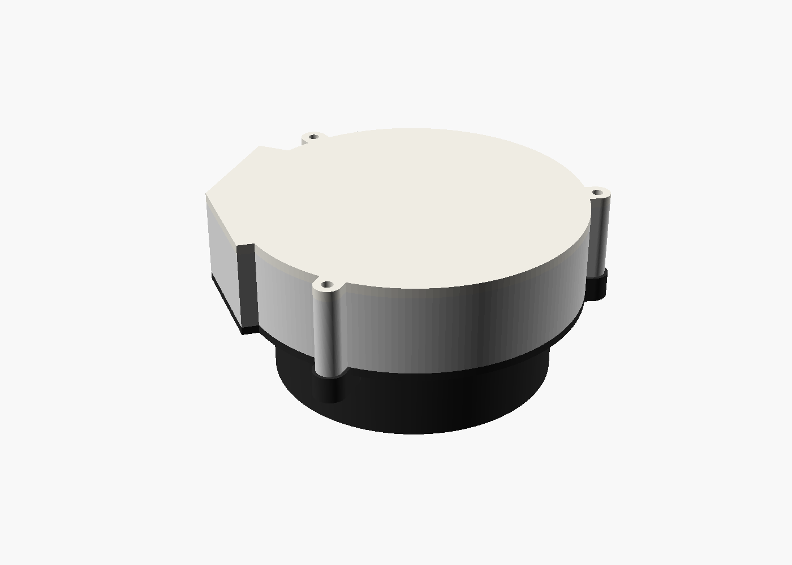

A finished panel, lit and running from a 12 V power bank:

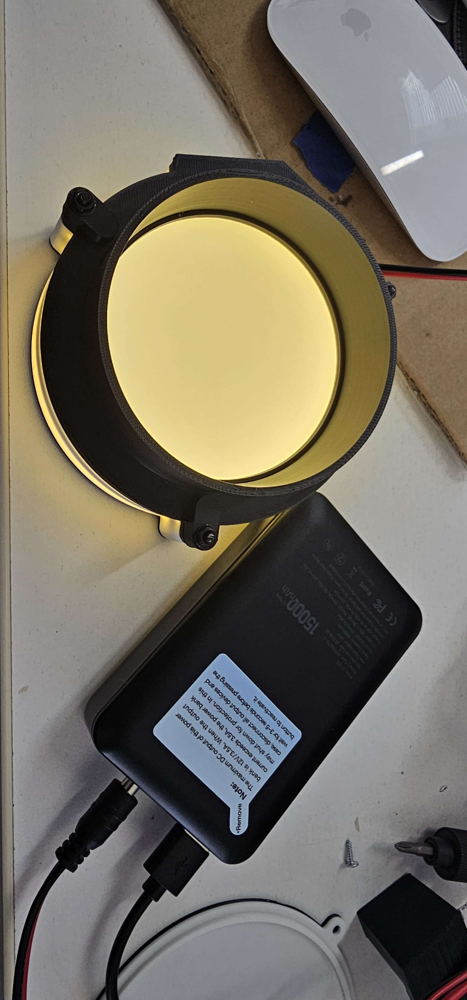

Contents: [How it works](#how-it-works) · [Bill of materials](#bill-of-materials) · [Files](#files-in-this-repo) · [Printing](#printing) · [Assembly](#assembly) · [Using it](#using-it) · [Optional extras](#optional-extras) · [OpenSCAD file](#openscad-file) · [To do](#to-do) · [Appendix: scaling](#appendix-scaling-to-other-scopes-unverified)

---

## How it works

Light from the LED strip never shines straight at the diffuser. The strip stands on edge in a ring around a small baffle skirt, so it only reaches the diffuser after bouncing around the cavity, which evens the light out. The diffuser disc sits in a recess in the front of the surround and is clamped by the collar flange. The collar is the slip-on part that goes over the telescope's dew shield.

Part order, from the telescope side to the back:

| # | Part | What it does |
|---|------|--------------|
| 1 | **Collar** | Slides over the RedCat dew shield (81 mm inside diameter, stops against an internal lip). Its flange clamps the diffuser. Each of its three tabs holds an M3 nut in a pocket. |
| 2 | **Diffuser disc** | 88 mm printed disc: a 1.0 mm thin centre with a raised rim that fills the recess. Drops into the surround's front recess. |
| 3 | **Surround** | Holds the diffuser, the baffle skirt, the LED ring, a channel for the strip connector, and a pocket for the buck converter (the "puck" in the scad file). |
| 4 | **Back wall** | Closes the cavity and the converter pocket. A thin spigot ring locates it in the surround. **Print it in white** - its inside face is the reflector that bounces the LED light toward the diffuser. |

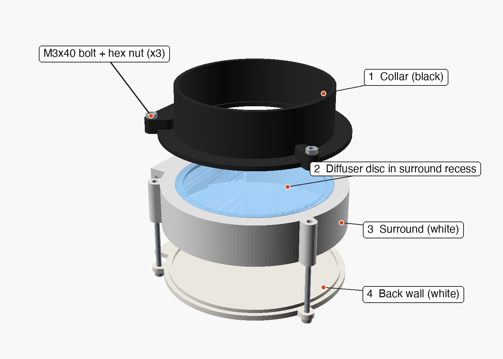

### Where everything fits

The back wall is left off in this view so you can see inside. The strip connector sits in the channel next to the converter pocket, and the wires run through the open slot between them.

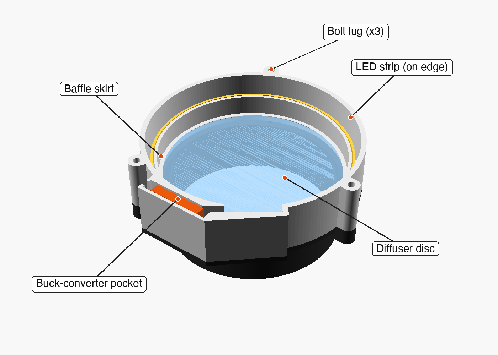

Render colours only tell the parts apart. For the real build, see [Filament colours](#filament-colours): the back wall must be white.

---

## Bill of materials

Full list with short Amazon links: **[bom/BOM.pdf](bom/BOM.pdf)** (source: [bom/bom.html](bom/bom.html)). The PDF also lists the optional items; none are needed.

| Item | Notes |
|------|-------|
| 22 AWG solid hook-up wire, red + black | |
| 12 V LED strip, SMD 2835, natural white 4500 K, 10 mm wide | About 30 cm used. Non-waterproof is fine. |
| MP1584EN buck converter | 1 of the 8-pack. Its trim pot sets the brightness. |
| 12 V barrel-plug pigtails, 2.1 x 5.5 mm | Plug into your existing 12 V supply. |
| PLA+ filament, black + white | The back wall must be white. |
| 3 x **M3x35** bolts, 3 x M3 hex nuts | From any M3 screw kit. |
| 12 V power source | Not in the BOM. Use your rig's. A 12 V DC power bank works too (as in the photo above). |

The diffuser is printed ([stl/flat_panel_diffuser.stl](stl/flat_panel_diffuser.stl)), so there is nothing to buy for it.

**Tools:** soldering iron, rosin-core solder, heat-shrink tubing, multimeter, small screwdriver (for the trim pot, assembly only).

### Cost of one panel

The BOM shows pack prices. One panel uses a slice of each pack:

| Material | Used | Cost |
|----------|------|------|
| PLA+ (all parts, printed diffuser included) | up to ~130 g | ~\$1.50 |
| LED strip | ~0.3 m of 5 m | ~\$0.90 |
| Buck converter | 1 of 8 | ~\$0.95 |
| DC pigtail pair | 1 of 5 | ~\$1.20 |
| Hook-up wire | ~2 ft | ~\$0.30 |
| M3 bolts + nuts | 3 + 3 | ~\$0.15 |
| **Total** | | **about \$5** |

---

## Files in this repo

```
stl/                          The four parts to print:
    flat_panel_collar.stl       with an M3 nut pocket in each tab
    flat_panel_surround.stl
    flat_panel_back.stl
    flat_panel_diffuser.stl     1.0 mm centre + raised rim
optional/                     Alternatives, none needed (see Optional extras)
scad/flat_panel.scad          Parametric OpenSCAD source (all parts)
scad/export_stls.sh           Exports every STL in one command
bom/BOM.pdf, bom/bom.html     Bill of materials (PDF with short links, and its source)
docs/                         Pictures used in this README (docs/images/) and the scripts that make them
```

`docs/render_images.sh` regenerates the pictures (OpenSCAD 2025 or newer, and Python 3 with Pillow).

---

## Printing

All four parts print **without supports**, in the orientation they are modelled in:

| Part | Orientation on the bed |
|------|------------------------|
| Back wall | Flat on the bed, spigot ring pointing up (**in white**, see below) |
| Surround | Front face (the diffuser recess side) on the bed |
| Collar | Flange on the bed, tube pointing up. The nut pockets open upward, so no supports |
| Diffuser | Flat (back) face on the bed, rim up (white, solid) |

| Back wall | Surround (shown from its open side) | Collar |
|:--:|:--:|:--:|
| 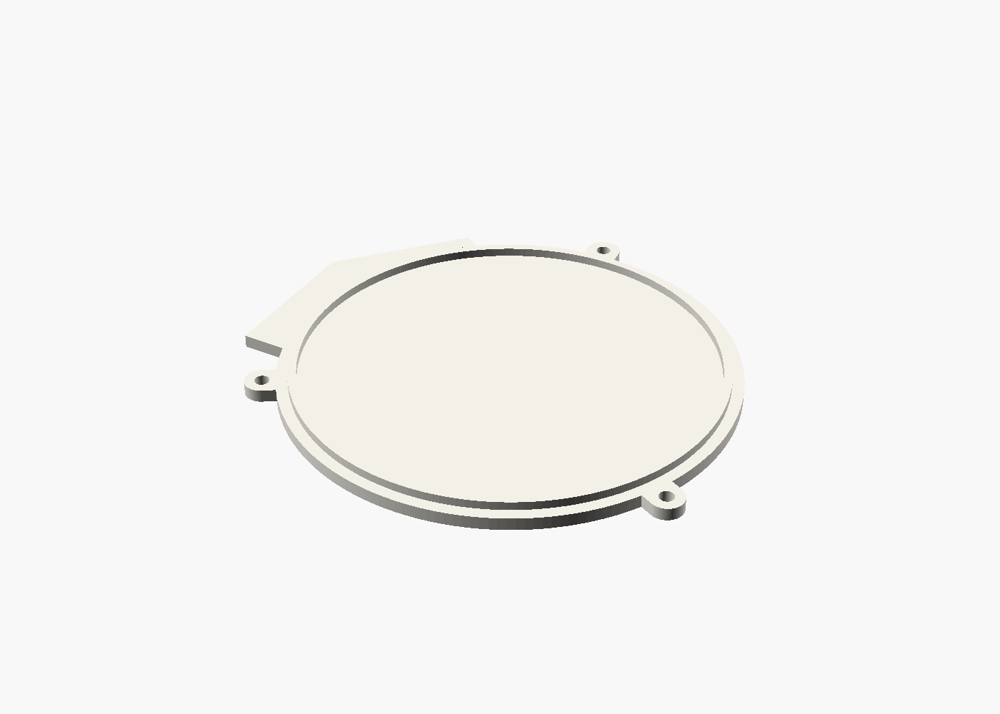 | 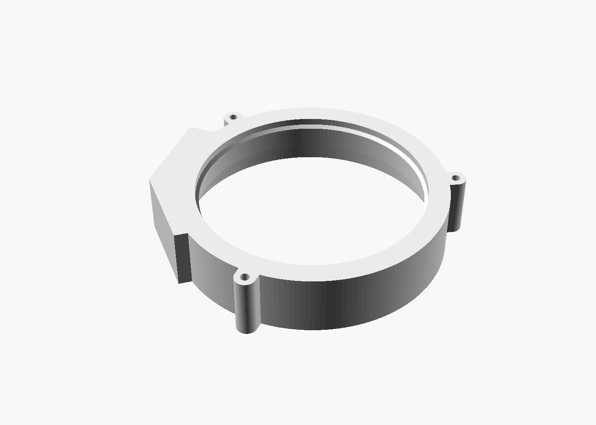 | 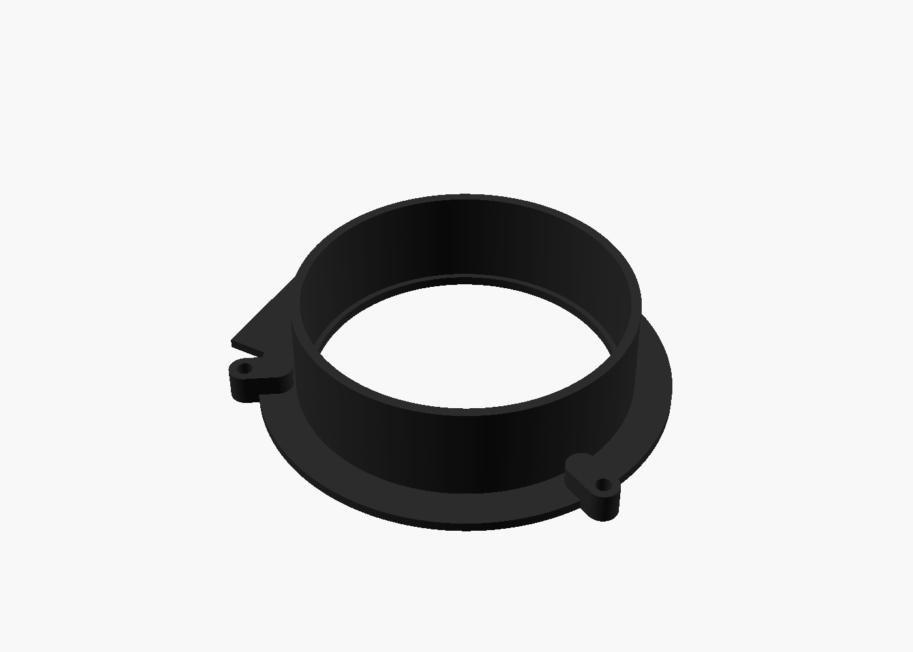 |

**Print every STL in its original orientation**, as it opens in your slicer. Don't flip, rotate or mirror it.

### Filament colours

**The back wall must be white.** Its inside face is what reflects the LED light back toward the diffuser, so a dark back wall wastes light and makes the panel dimmer and less even.

* **Single-colour printer:** print the whole back wall in white.
* **Multi-colour printer (e.g. Bambu AMS):** you can print the back wall in any colour as long as the top is white - the spigot side that faces into the cavity. Cover that top face with white layers.

The cavity walls of the surround reflect light in the same way, so light plastic there helps for the same reason; the collar's colour doesn't affect the light.

### Diffuser

An 88 mm disc with a **1.0 mm thin centre** that passes the light and a **raised rim** that fills the rest of the surround's 3 mm recess, so the collar flange still clamps it.

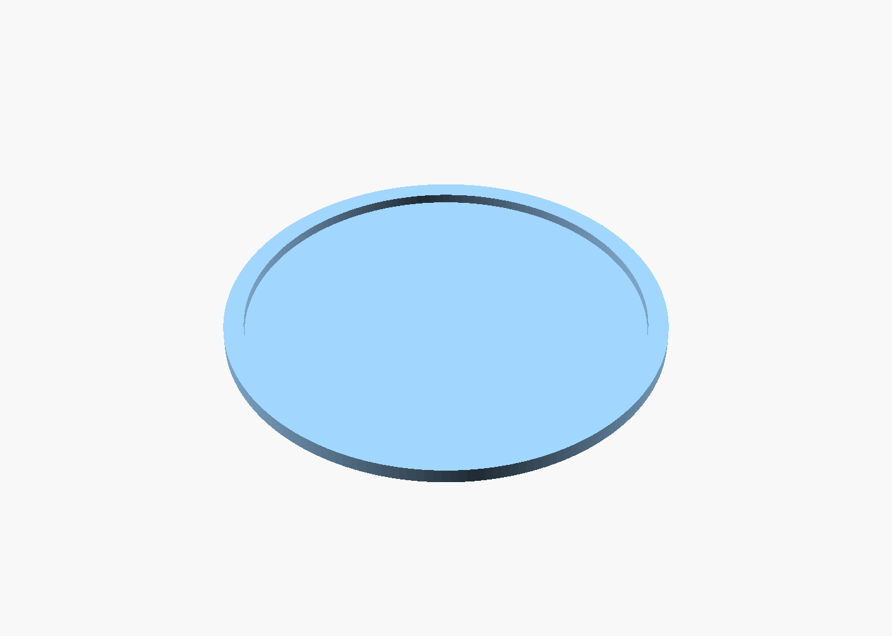

* Print it **flat face down, rim up**, in white filament, solid (100 % infill; the centre is only a few layers). The flat face is the back (LED side) of the disc and the rim is its front face.
* The rim sits under the collar flange, so it never blocks light.
* Check that it drops into the recess without forcing. If it is tight or loose on your printer, change `diffuser_d` in the scad and re-export the surround and the diffuser.

### Nut pockets in the collar

Each collar tab has a hex pocket in its free (scope-side) end for a standard M3 nut (5.5 mm across flats, 2.4 mm thick), so the bolt is a short **M3x35** and there is no loose nut to hold at the tab end.

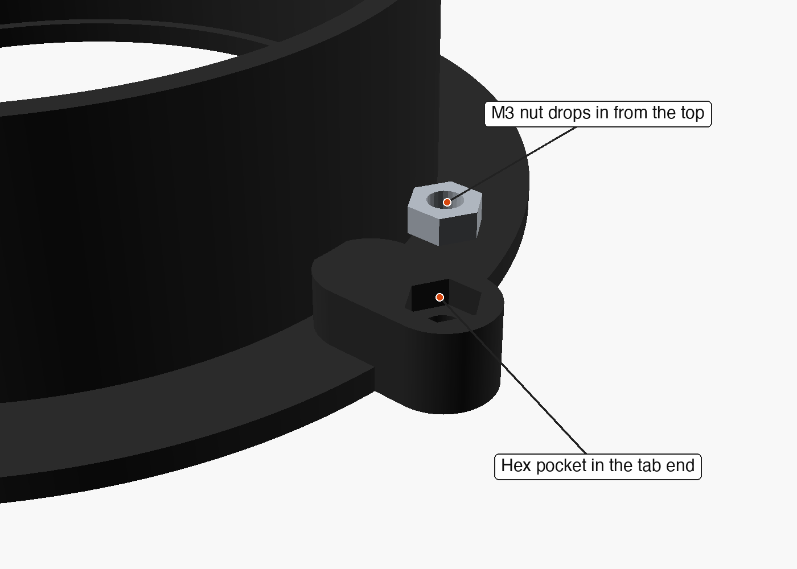

* The pocket is open at the top as printed, so there is nothing to bridge and the nut drops in from above.
* The bolt (back wall 3 + surround 24 + tab 8 = 35 mm) just reaches through the nut, about 0.2 mm past it. A slightly longer bolt also works; it just sticks out past the tab.
* If a nut won't drop in, ream the pocket gently, or raise `nut_clear` (default 0.2 mm per side) and re-export.
* The nut is held only by the pocket walls, so it can fall out if you turn the collar over before the bolt is in. Tape or poster putty over the tab end holds it until the bolts are threaded (see steps 4 and 9).

---

## Assembly

Do a dry fit of the printed parts and the diffuser before you wire anything.

**Wire you will need:** between the buck converter (the puck) and the LED strip you need **1 to 2 inches (25-50 mm) of hook-up wire**, enough to run from the connector channel into the converter pocket through the side slot (step 3). The leads from the converter to your 12 V supply must be long enough to reach it (step 2).

1. **Print the parts.** Print the four parts in [stl/](stl/): collar, surround, back wall and diffuser. Clean any elephant's foot off the edges so the parts seat flat.
2. **Wire the converter.** Solder the pigtail's two leads to the converter's **IN+ / IN-** pads. Plug the pigtail into your 12 V supply and, with a multimeter on **OUT+ / OUT-**, check what it reads. These converters usually ship set to a very low output, so leave the trim pot alone for now. Unplug before continuing. Heat-shrink the joints.
   **If the pigtail won't reach your 12 V port:** solder an extension of the hook-up wire (red +, black -) between the pigtail and the converter's **IN+ / IN-** pads, long enough to reach the port with some slack. Check which pigtail lead is + with the multimeter first (the barrel's centre pin is usually +), and heat-shrink each joint. Do this now, before the converter goes into its pocket.
3. **Prepare the strip.** Cut about 30 cm of LED strip at a cut mark (roughly pi x the skirt's 93 mm outside diameter). Solder two wires (red = +, black = -) to the pads at the **start** of the strip, and heat-shrink or tape the joints. Connect the other ends to the converter's **OUT+ / OUT-** pads. **Leave 1 to 2 inches (25-50 mm) of wire between the strip and the converter.**
4. **Seat the diffuser.** Lay the surround on the bench with its front face up and drop the diffuser disc into the recess, **rim face up** (flat face down) - it rests on the 45-degree seat and should sit flush with the front face. Place the collar on top, flange down, lining up the three bolt lugs and the connector-box outline, so the flange clamps the disc's edge.
   **Nuts:** drop an M3 nut into the pocket in each collar tab end first, and hold it there with a bit of tape or poster putty until the bolts are in.
5. **Flip the stack so the open back faces you.** Press the strip around the outside of the baffle skirt, standing on its edge on the front ring, with the **LEDs facing outward toward the cavity wall**. The strip has a self-adhesive back covered by a removable backing: **peel the backing off if you want the strip to stick to the surround**; otherwise leave it on. Drop the soldered end of the strip into its channel (it slides in from the open back and rests on the front ring).
6. **Fit the converter.** Slide the buck converter into its pocket from the back, then feed its wires through the slots as shown in the picture above (strip wires through the side slot, DC input leads out through the slot at the far end of the pocket). Leave the DC leads long enough to reach your supply (extend them as in step 2 if not).
7. **Test fit and set the brightness.** Plug in the supply. **Don't be alarmed if you see no light at first:** the converter's output is set very low by default, so on your first power-up the strip will probably look off. Turn the trim pot up slowly (a small screwdriver, with the multimeter on the output if you like) until the strip comes on, then check that the diffuser glows evenly and fix any pinched wires. Then, with the back wall still off, slide the collar onto your scope, take short test exposures with your camera, and turn the trim pot until the exposure is where you want it for flats, e.g. a histogram peak in the middle of the range at an exposure time you're happy with. Aim for a level that works across all your filters, since you'll fine-tune later with exposure time or gain. Unplug when you're done.
8. **Close the back.** Seat the back wall's spigot ring into the surround, keeping wires clear of the lugs and the edge.
9. **Bolt it together.** Push an **M3x35 bolt** through each lug from the back wall side and thread it into the nut sitting in the collar tab (the bolt pushes through the tape). Tighten evenly, just snug - it's plastic.

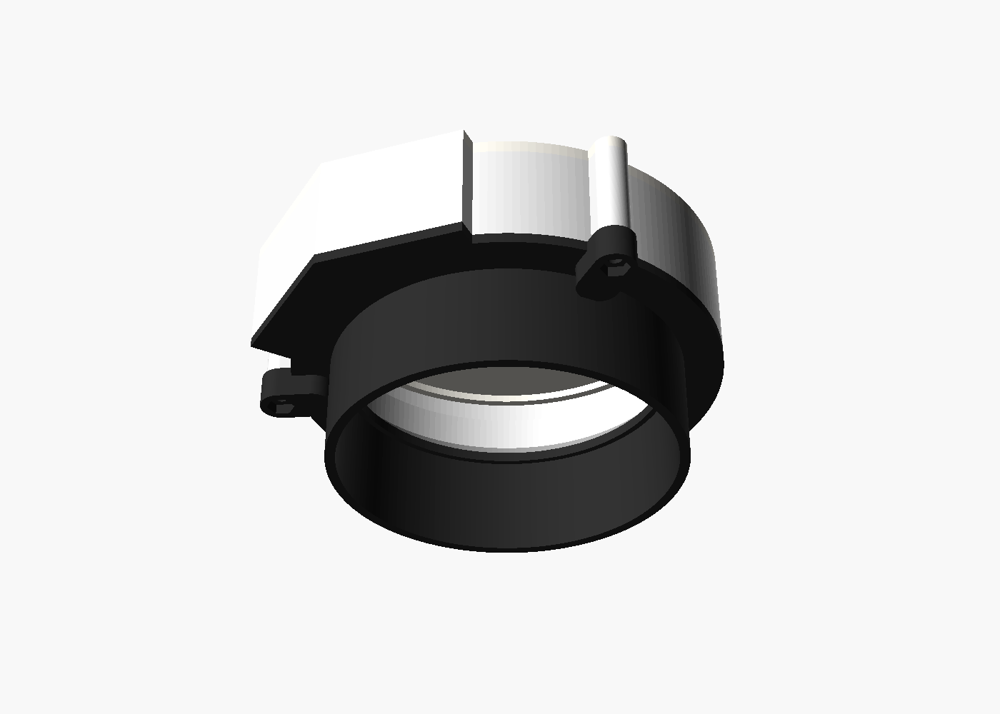

---

## Using it

1. Slide the collar over the RedCat's dew shield until it stops against the internal lip.
2. Plug the pigtail into 12 V.
3. Take your flats, changing exposure time or gain per filter as needed, then slip the panel off and store it somewhere dry.

**Not weatherproof:** the panel is not sealed, so keep it dry and out of dew, rain and damp air. Don't leave it on the scope outside, and use it only while taking flats.

If the brightness is wrong for your setup, unbolt the back wall and re-adjust the trim pot (assembly step 7).

---

## Optional extras

Everything above is the complete build. The items below are alternatives and add-ons; none are needed for a working panel, and each says which assembly step it changes. The alternative STLs are in [optional/](optional/).

### Thinner diffuser (0.6 mm centre)

[optional/flat_panel_diffuser_0.6mm.stl](optional/flat_panel_diffuser_0.6mm.stl) is the same diffuser with a 0.6 mm centre. It fits the same surround. Print it in place of the standard diffuser (steps 1 and 4); nothing else changes.

### Heat-set inserts instead of nuts

Print [optional/flat_panel_collar_heat_insert.stl](optional/flat_panel_collar_heat_insert.stl) instead of the standard collar. Its tabs are plain, with a hole for an M3 heat-set insert (`insert_d`, 4.0 mm by default; check your insert's recommended hole size).

* **Step 4:** melt an insert into each tab hole first. There are no nuts and no tape.
* **Step 9:** the same M3x35 bolts thread straight into the inserts.

### Solderless strip connectors

COB strip-to-wire clip connectors (10 mm, 2-pin) replace soldering the wires to the strip pads. The connector channel in the surround is sized for them.

* **Step 3:** clip the red and black wires onto the start of the strip with a connector instead of soldering them.
* **Step 5:** drop the connector into the channel.

### Strain relief for the power lead

Do this after step 9. Fix the power lead to the side of the panel with a small dab of **low-temperature hot glue**, so the wire doesn't flop around and the pull is taken by the glue instead of the solder joints and thin wires inside. Leave a little slack between the glue and the panel's wire slot.

**Careful: PLA softens at fairly low temperatures, so use a low-temp glue gun, keep the dab small, and don't hold the hot nozzle against the plastic.** A cable tie, a strip of tape or double-sided foam tape also works without any heat.

### Soldering flux

Helps solder stick. Rosin-core solder alone works.

---

## OpenSCAD file

[scad/flat_panel.scad](scad/flat_panel.scad) is a single file that produces every part. It works with [OpenSCAD](https://openscad.org) 2021.01 or newer.

**Export every STL in one command:**

```bash
scad/export_stls.sh
```

This rewrites everything in `stl/` and `optional/`. To keep the shipped STLs, give it a folder and add your own settings after `--`, for example `scad/export_stls.sh my_build -- -D diffuser_d=89` (it writes `my_build/stl` and `my_build/optional`).

**In the OpenSCAD GUI:** open the file, open the Customizer (Window menu), and pick a part from the `part` drop-down. `all` shows it assembled, `exploded` shows how it fits together. Press F6 to render, then File > Export > STL. The exported parts are already in their print orientation.

### Settings

For the RedCat you don't need to change anything. If you want to, these are the ones that matter. All lengths are millimetres.

| Parameter | Default | Meaning |
|-----------|---------|---------|
| `collar_id` | 81 | Inside diameter of the slip-on collar. **Measure your scope's dew shield and add about 1 mm.** |
| `collar_depth` | 25 | How far the collar slides on. |
| `diffuser_d` | 88 | Diffuser disc diameter. The recess, light opening, skirt and cavity are all worked out from this. |
| `diffuser_center_t` | 1.0 | Thickness of the thin centre of the printed diffuser (0.6 for the thinner one). |
| `cavity_depth` | 20 | LED chamber depth. The baffle skirt length follows it. |

Everything else (wall thickness, back wall, wire slots, strip connector, converter pocket, bolt lugs, nut pockets) is under "Advanced" in the Customizer and documented in a comment beside each line in the file. These are sized to the parts in the BOM; re-measure and adjust them only if you use a different connector, converter, nut or bolt.

Some values are worked out from the settings above, so they don't show in the Customizer: `lip_id` (`collar_id` - 3), `diffuser_recess_d` (`diffuser_d` + 0.5), `seat_id` (`diffuser_d` - 2), `skirt_id` (`diffuser_d` + 2), `cavity_id` (`diffuser_d` + 12) and `skirt_len` (`cavity_depth` / 2). You can still override any of them from the command line, e.g. `-D skirt_len=12`.

---

## To do

1. Update the surround so the converter (puck) can be reached from outside, to make the light dimmable without opening the panel.
2. Investigate wireless control of the light, for on/off and dimming.
3. Possibly build a N.I.N.A. plugin that integrates light dimming.

---

## Appendix: scaling to other scopes (unverified)

> **Unverified.** Nothing in this appendix has been printed or tested at other sizes. It rests on a render and a simple light simulation only. Test-print the collar first, since it is the part that has to fit your scope. The RedCat 51 II build above is the only tested one.

The panel is sized from the diffuser outwards, so scaling is mostly a matter of choosing two numbers, `collar_id` and `diffuser_d`; the rest follows (see [Settings](#settings)).

1. Measure the outside diameter of the end of your scope (dew shield or hood) the collar will slip over, and set `collar_id` to that plus about 1 mm. The stop lip (`lip_id`, `collar_id` - 3) must still be bigger than your optics' clear aperture.
2. Choose `diffuser_d`: bigger than the collar's outside diameter (`collar_id` + 2 x `wall`), here about 2 mm bigger.
3. Set `cavity_depth` to about 0.3 x `diffuser_d` for larger panels (the RedCat's 20 mm is about 0.23; see the limits below).
4. Set `part` to `all` and `exploded` and look for anything that touches or sticks out, then export each part (`scad/export_stls.sh my_build -- -D collar_id=... -D diffuser_d=...`, which leaves the shipped STLs alone). Check that `diffuser_rim_w` still leaves the diffuser's rim inside `lip_id`.
5. Cut your LED strip to roughly pi x (`skirt_id` + 2 x `skirt_t`). The bolts need to be about `cavity_depth` + 15 mm long (the default 20 gives the M3x35).

For example, a ~108 mm scope end. The deeper cavity keeps the light even at this size (see below), and means M3x50 bolts:

```bash
openscad -o my_surround.stl -D 'part="surround"' \
  -D collar_id=108 -D diffuser_d=118 -D cavity_depth=35 \
  scad/flat_panel.scad
```

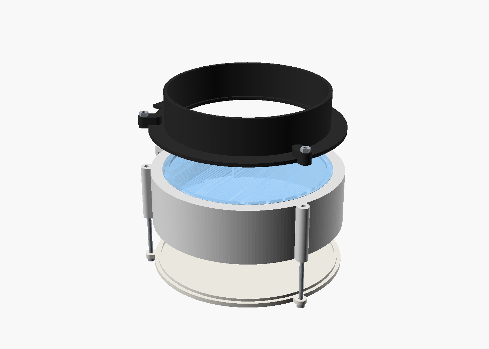

Things that **do not** scale automatically: the M3 hardware, the strip connector pocket, the converter pocket, and the wire slots. They are sized to the parts in the BOM.

### Limits of scaling up

**Short answer: with the default 20 mm cavity the ring of LEDs stops lighting the panel evenly at roughly 100-120 mm of diffuser. A 12-inch panel needs a much deeper cavity, a brighter light source, and a very big printer.**

The reason is the light path. The strip stands outside the baffle skirt facing the wall, so light only reaches the diffuser after bouncing around the cavity. At 88 mm that is a short trip; at larger sizes the centre is much farther from the LEDs and the cavity is still only 20 mm deep, so the rim gets bright and the centre goes dim.

I checked the trend with a simple ray-tracing model of the cavity ([docs/cavity_sim.py](docs/cavity_sim.py): white diffuse walls at an assumed 75 % reflectance, LED ring outside the skirt, the diffuser as a perfect light sink). It is a toy: it ignores the strip body and any scattering inside the diffuser, and nothing has been printed or measured at the larger sizes. Use it for the **trend relative to the 88 mm design**, not as a prediction. (Changing the assumed reflectance between 60 % and 90 % barely moves the evenness.)

Brightness at the **centre of the diffuser as a fraction of the brightness at its edge** (1.00 would be perfectly even):

| Diffuser diameter | Default depth (20 mm) | Depth about 0.3 x diameter, skirt half that | Light output vs the 88 mm panel* |
|-------------------|-----------------------|----------------------------------------------|----------------------------------|
| 88 mm (RedCat) | 0.64 | - | 100 % |
| 100 mm | 0.55 | - | - |
| 118 mm | 0.42 | 0.84 (depth 35) | ~30 % |
| 150 mm | 0.28 | 0.83 (depth 45) | ~15 % |
| 200 mm | 0.18 | 0.86 (depth 60) | ~7 % |
| 305 mm (12 in) | 0.09 | 0.95 (depth 92) | ~2 % |

\* Same LED strip density and drive. The deeper cavity that fixes the evenness loses a lot of light, and the bigger panel has more area to cover.

What that means:

* **Where it stops (my estimate):** around **100-120 mm** with the default depth. By 118 mm the centre is down to about 40 % of the edge, and below 30 % by 150 mm. Even the 88 mm design isn't perfectly flat in this toy model (centre about 64 % of the edge before the real diffuser smooths it out), so don't go beyond about 100 mm without deepening the cavity.
* **Deepen the cavity:** setting `cavity_depth` to about 0.3 x the diffuser diameter, with `skirt_len` half of that, brought the toy model back to even or better than the 88 mm design at every size I tried, up to 12 inches. I haven't tested other combinations.
* **12 inches (305 mm) is not a one-line change.** With a ~92 mm deep cavity it is optically plausible, but:
  * **Light output** drops to roughly 1/50 of the 88 mm panel for the same strip, so it may be too dim even at full converter output. You would want a denser strip or a second ring, which this design doesn't have.
  * **Printer size:** the parts would be about 322 x 329 mm, which won't fit a typical 220-256 mm bed. The surround and back wall alone are about 460 g and 310 g of PLA at 100 % infill.
  * **Bolts:** with that depth the bolt length is about 107 mm, so M3x110 bolts or threaded rod, not the M3x35 from the kit.
  * **Diffuser:** a 1.0 mm printed centre will sag across 305 mm even with the rim; it would need support or a stiffer disc.
  * **Cost:** roughly **\$15-20** of materials by the same per-unit maths as above: up to ~990 g of PLA (about \$11 at the BOM's price, less with normal infill), ~1 m of strip (~\$3), plus the converter, pigtail and wire (~\$2.50). Long bolts are extra and I haven't priced them.

If you build a bigger one, take a test flat first: a panel that is bright at the rim and dim in the centre gives uneven illumination, which is exactly what flats are supposed to avoid.

---

## License

Copyright (c) 2026 khanmark.

This project is licensed under the [Creative Commons Attribution-ShareAlike 4.0 International](https://creativecommons.org/licenses/by-sa/4.0/) license (CC BY-SA 4.0); the full text is in [LICENSE](LICENSE). You may print, share and modify it, including for your own scopes, as long as you credit the original and share your changes under the same license.
